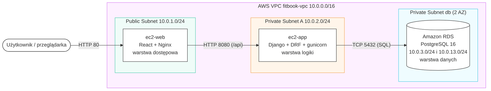

# FitBook

## O projekcie
FitBook to aplikacja webowa do rezerwacji zajęć fitness. Klienci przeglądają grafik zajęć, następnie się na nie zapisują, mogą również zarządzać swoimi rezerwacjami.  Instruktor lub recepcja tworzy zajęcia, ustala limity miejsc i widzi listę uczestników. Administrator może wszystko, w tym zarządzać rolami użytkowników. Aplikacja działa w architekturze 3-warstwowej w chmurze AWS.

Projekt realizowany jest w 4-osobowym zespole w ramach przedmiotu „Projekt zespołowy” na Uniwersytecie WSB Merito we Wrocławiu.

## Zespół

| Rola | Osoba | GitHub |
|---|---|---|
| PM / DevOps | Krzysztof Okołotowicz | @M1lachite |
| Frontend | Aneta Krzykwa | @Aneta2508 |
| Backend | Konrad Leśny | @Albako |
| DBA | Karolina Wasilewska | @KaWas866 |

## Technologie

- Chmura: AWS
- Front-end: React + Vite, react-bootstrap, serwowany przez Nginx
- Back-end: Python, Django, Django REST Framework, JWT (simplejwt), gunicorn
- Baza danych: PostgreSQL 16 (Amazon RDS)
- Infrastruktura:  AWS (VPC, podsieci, Security Groups, EC2), Terraform
- Konteneryzacja: Docker, Docker Compose

## Architektura



Przepływ danych:

1. Przeglądarka pobiera statyczne pliki aplikacji React serwowane przez Nginx (Public Subnet).
2. React wysyła zapytania REST pod adres `/api/...`. Nginx przekazuje je do backendu (Private Subnet A, port 8080).
3. Django weryfikuje token JWT oraz uprawnienia roli użytkownika, waliduje dane i wykonuje zapytania SQL do bazy (port 5432).
4. Odpowiedź JSON wraca tą samą ścieżką do przeglądarki, a React aktualizuje widok interfejsu.

Reguły Security Groups: warstwa web przyjmuje ruch z internetu (80, 443), app przyjmuje ruch tylko od web (8080), a baza tylko od app (5432). Maszyny w podsieciach prywatnych nie mają adresów publicznych.

## Struktura repozytorium

```
fitbook/
├── .env.example              # Szablon zmiennych środowiskowych (baza, Django); prawdziwy .env nie trafia do repo
├── .gitignore                # Wykluczenia z gita (.env, .venv, node_modules, dist, stan Terraforma)
├── docker-compose.yml        # Orkiestracja lokalna: baza PostgreSQL + backend + frontend
├── LICENSE                   # Licencja projektu
├── README.md                 # Główna dokumentacja projektu
├── docs/                     # Dokumentacja projektowa, diagramy i schematy
│   └── architecture.png
│
├── backend/                  # Warstwa logiki (Django + Django REST Framework)
│   ├── config/               # Konfiguracja projektu (settings, główne adresy URL)
│   ├── accounts/             # Moduł użytkowników, ich rejestracja, logowanie JWT, role i uprawnienia
│   │   ├── models.py         #   model użytkownika z rolą (CLIENT, INSTRUCTOR, ADMIN)
│   │   ├── permissions.py    #   uprawnienia zależne od roli
│   │   ├── serializers.py    #   walidacja danych rejestracji i użytkowników
│   │   ├── views.py, urls.py #   endpointy /api/auth/ i /api/users/
│   │   └── migrations/       #   migracje bazy danych
│   ├── schedule/             # Moduł zarządzania grafikiem zajęć (FitnessClass) i rezerwacjami (Booking)
│   │   ├── models.py         #   modele i ograniczenia integralności
│   │   ├── serializers.py    #   walidacja danych zajęć i rezerwacji
│   │   ├── views.py, urls.py #   endpointy /api/classes/ i /api/bookings/
│   │   └── migrations/       #   migracje bazy danych
│   ├── Dockerfile            # Obraz backendu (Python 3.12, gunicorn na porcie 8080)
│   ├── .dockerignore         # Wykluczenia z kontekstu budowania (.venv, .env, cache)
│   ├── manage.py             # Narzędzie wiersza poleceń Django
│   └── requirements.txt      # Zależności Pythona (Django, DRF, simplejwt, psycopg, python-dotenv, gunicorn)
│
├── frontend/                 # Warstwa interfejsu (React + Vite + react-bootstrap)
│   ├── src/
│   │   ├── api/              # Klient HTTP (client.js: token JWT, błędy) i funkcje wywołań endpointów
│   │   ├── components/       # Komponenty wielokrotnego użytku (pasek dni, wiersz zajęć, okna, trasy chronione)
│   │   ├── context/          # Stan globalny: zalogowany użytkownik i komunikaty (toasty)
│   │   ├── pages/            # Widoki stron: grafik, rezerwacje, panel instruktora, użytkownicy, logowanie, rejestracja
│   │   ├── utils/            # Funkcje pomocnicze (obliczenia na datach)
│   │   ├── App.jsx           # Menu zależne od roli i tabela tras
│   │   ├── main.jsx          # Punkt startowy aplikacji
│   │   └── theme.css         # Motyw kolorystyczny i czcionka
│   ├── public/               # Pliki statyczne
│   ├── .env.example          # Szablon adresu API (VITE_API_URL)
│   ├── Dockerfile            # Budowanie dwuetapowe: build Reacta, potem serwowanie przez Nginx
│   ├── .dockerignore         # Wykluczenia z kontekstu budowania (node_modules, dist, .env)
│   ├── nginx.conf.template   # Konfiguracja Nginx: pliki statyczne i reverse proxy /api do backendu
│   ├── index.html            # Strona HTML, w której działa aplikacja React
│   ├── package.json          # Zależności Node.js i skrypty npm
│   ├── eslint.config.js      # Reguły lintera (npm run lint)
│   └── vite.config.js        # Konfiguracja Vite i proxy deweloperskie /api
│
└── infrastructure/           # Kod infrastruktury chmurowej (IaC, Terraform) – AWS
    ├── main.tf               # Wywołanie modułów
    ├── variables.tf          # Zmienne (nazwa projektu, region)
    ├── terraform.tfvars      # nazwa projektu i region
    ├── outputs.tf            # Wyjścia: identyfikatory zasobów i adresy IP
    ├── providers.tf          # Dostawca AWS
    ├── versions.tf           # Wymagane wersje Terraforma i dostawców
    ├── backend.tf            # Zdalny stan Terraforma w S3
    ├── README.md             # Instrukcja wdrożenia infrastruktury
    └── modules/
        ├── network/          # VPC, podsieci web/app/db, Internet Gateway, NAT Gateway
        ├── security/         # Security Groups izolujące warstwy (web → app → db)
        ├── compute/          # instancje EC2 (web, app)
        └── rds/              # baza PostgreSQL (RDS)       
```

## Zmienne środowiskowe

Dane poufne są wyłącznie w zmiennych środowiskowych. Plik `.env` jest w `.gitignore`, a w repozytorium jest tylko szablon `.env.example`.

|Zmienna | Opis | Wartość lokalnie |
|---|---|---|
| `DJANGO_SECRET_KEY` | klucz kryptograficzny Django | własny, wygenerowany |
| `DJANGO_DEBUG` | tryb debugowania (w AWS: `False`) | `True` |
| `DJANGO_ALLOWED_HOSTS` | dozwolone nazwy hostów, rozdzielone przecinkami | `localhost,127.0.0.1` |
| `DB_NAME` | nazwa bazy | `fitbook` |
| `DB_USER` | użytkownik bazy | `fitbook` |
| `DB_PASSWORD` | hasło bazy | własne |
| `DB_HOST` | adres bazy (w Compose ustawiany automatycznie na `db`) | `localhost` |
| `DB_PORT` | port bazy (lokalnie 5433, w AWS 5432) | `5433` |
| `VITE_API_URL` (frontend) | adres API używany przez React | `/api` |
| `BACKEND_URL` (kontener Nginx) | adres backendu, do którego Nginx przekazuje `/api` | `http://backend:8080` |


## Instrukcja uruchomienia projektu:
## Uruchomienie lokalne (Docker Compose)

Wymagane oprogramownaie: Docker i Git.

```
git clone https://github.com/M1lachite/fitbook.git
cd fitbook
copy .env.example .env
```

Na Linuksie i macOS zamiast `copy` użyj `cp`. Uzupełnij plik `.env` (opis zmiennych poniżej). 
Klucz DJANGO_SECRET_KEY wygenerujesz poleceniem:

```
python -c "import secrets; print(secrets.token_urlsafe(50))"
```

Uruchomienie:

```
docker compose up --build -d
```
Komenda służąca do utworzenia konta administratora:
```
docker compose exec backend python manage.py createsuperuser
```
Aplikacja jest dostępna pod adresem:
Frontend: **http://localhost:8080**. Backend API: http://localhost:8001/api/. Zatrzymanie: `docker compose down` (dane bazy zostają w wolumenie, flaga `-v` je usuwa).

## Uruchomienie w trybie deweloperskim

Baza w kontenerze, backend i frontend bezpośrednio na komputerze.

**1. Baza danych** (z głównego folderu fitbook):

```
docker compose up -d db
```

**2. Backend** (wymagany Python 3.10 lub nowszy, w pliku `.env` ustaw `DB_HOST=localhost` i `DB_PORT=5433`):

```
cd backend
python -m venv .venv
.venv\Scripts\Activate.ps1
pip install -r requirements.txt
python manage.py migrate
python manage.py createsuperuser
python manage.py runserver 8001
```

**3. Frontend** (wymagany Node.js 20.19 lub nowszy):

```
cd frontend
copy .env.example .env.local
npm install
npm run dev
```

Aplikacja jest dostępna pod adresem http://localhost:5173. Serwer deweloperski przekazuje zapytania `/api` do backendu na porcie 8001.

## Role użytkowników

| Rola | Uprawnienia                                                                                         |
|---|-----------------------------------------------------------------------------------------------------|
| Klient (`CLIENT`) | przegląda grafik zajęć, zapisuje się na zajęcia, zarządza własnymi rezerwacjami                     |
| Instruktor / recepcja (`INSTRUCTOR`) | dodatkowo tworzy, edytuje i usuwa zajęcia, ustala limity miejsc, widzi listę zapisanych uczestników |
| Administrator (`ADMIN`) | wszystkie uprawnienia oraz zarządzanie użytkownikami i ich rolami                                   |

Rejestracja zawsze tworzy konto klienta. Zmiana roli na instruktora lub administratora wymaga interwencji konta z uprawnieniami administratora.

## Dokumentacja REST API

Wszystkie zasoby są dostępne pod prefiksem `/api`. Endpointy chronione wymagają nagłówka `Authorization: Bearer <token_access>`. Dostęp „Zalogowany" oznacza każde konto po zalogowaniu użytkownika, niezależnie od roli.

| Metoda | Endpoint | Dostęp | Opis                                                  | Kody statusu |
|---|---|---|-------------------------------------------------------|---|
| POST | `/api/auth/register/` | Publiczny | Rejestracja nowego konta klienta                      | 201, 400 |
| POST | `/api/auth/login/` | Publiczny | Logowanie i uwierzytelnienie, zwraca parę tokenów JWT | 200, 400, 401 |
| POST | `/api/auth/refresh/` | Publiczny | Odświeżenie tokenu access tokenem refresh             | 200, 401 |
| GET | `/api/auth/me/` | Zalogowany | Pobranie profilu i roli zalogowanego użytkownika      | 200, 401 |
| GET | `/api/classes/` | Publiczny | Lista zajęć (filtry: `from`, `to`, `instructor`)      | 200, 400 |
| GET | `/api/classes/{id}/` | Publiczny | Szczegółowe informacje o zajęciach                    | 200, 404 |
| POST | `/api/classes/` | Instruktor, Admin | Dodanie nowych zajęć                                  | 201, 400, 401, 403 |
| PUT | `/api/classes/{id}/` | Instruktor, Admin | Pełna edycja danych zajęć (komplet pól)               | 200, 400, 401, 403, 404 |
| PATCH | `/api/classes/{id}/` | Instruktor, Admin | Częściowa aktualizacja danych zajęć                   | 200, 400, 401, 403, 404 |
| DELETE | `/api/classes/{id}/` | Instruktor, Admin | Usunięcie zajęć i powiązanych rezerwacji              | 204, 401, 403, 404 |
| GET | `/api/classes/{id}/participants/` | Instruktor, Admin | Pobranie listy zapisanych uczestników                 | 200, 401, 403, 404 |
| GET | `/api/bookings/` | Zalogowany | Lista rezerwacji aktualnego użytkownika               | 200, 401 |
| POST | `/api/bookings/` | Zalogowany | Zapisanie się na wybrane zajęcia                      | 201, 400, 401 |
| DELETE | `/api/bookings/{id}/` | Zalogowany | Anulowanie własnej rezerwacji                         | 204, 401, 404 |
| GET | `/api/users/` | Admin | Lista wszystkich kont użytkowników                    | 200, 401, 403 |
| PATCH | `/api/users/{id}/` | Admin | Zmiana roli wybranego użytkownika                     | 200, 400, 401, 403, 404 |                                      | 200, 400, 401, 403, 404 |

### Kody odpowiedzi

| Kod | Znaczenie |
|---|---|
| 200 | sukces |
| 201 | zasób utworzony |
| 204 | usunięto, brak treści |
| 400 | błędne dane (walidacja, brak wolnych miejsc, podwójna rezerwacja) |
| 401 | brak lub wygasły token |
| 403 | brak uprawnień dla roli |
| 404 | nie znaleziono zasobu |
| 500 | błąd serwera |

### Przykłady

**Rejestracja** (`POST /api/auth/register/`)

```json
{
  "username": "jan",
  "email": "jan@example.com",
  "first_name": "Jan",
  "last_name": "Kowalski",
  "password": "Haslo-Testowe-123"
}
```

Odpowiedź `201`:

```json
{
  "id": 5,
  "username": "jan",
  "email": "jan@example.com",
  "first_name": "Jan",
  "last_name": "Kowalski"
}
```

**Logowanie** (`POST /api/auth/login/`)

```json
{ "username": "jan", "password": "Haslo-Testowe-123" }
```

Odpowiedź `200`:

```json
{ "refresh": "<token refresh>", "access": "<token access>" }
```

**Utworzenie zajęć** (`POST /api/classes/`)

```json
{
  "title": "Joga poranna",
  "description": "Spokojne zajęcia rozciągające",
  "instructor": "Anna Kowalska",
  "start_time": "2026-10-26T08:00:00+01:00",
  "capacity": 15
}
```

Odpowiedź `201`:

```json
{
  "id": 1,
  "title": "Joga poranna",
  "description": "Spokojne zajęcia rozciągające",
  "instructor": "Anna Kowalska",
  "start_time": "2026-10-26T08:00:00+01:00",
  "capacity": 15,
  "booked": 0
}
```

**Zapis na zajęcia** (`POST /api/bookings/`)

```json
{ "fitness_class": 1 }
```

Odpowiedź `201`:

```json
{
  "id": 1,
  "fitness_class": 1,
  "class_title": "Joga poranna",
  "instructor": "Anna Kowalska",
  "start_time": "2026-10-26T08:00:00+01:00"
}
```

**Błąd walidacji** (`400`), gdy brak wolnych miejsc:

```json
{ "detail": "Brak wolnych miejsc na te zajęcia." }
```

**Błąd walidacji pola** (`400`), np. limit miejsc równy 0:

```json
{ "capacity": ["Upewnij się, że ta wartość jest większa lub równa 1."] }
```

**Zmiana roli** (`PATCH /api/users/5/`)

```json
{ "role": "INSTRUCTOR" }
```


## Wdrożenie

_Do uzupełnienia._


# Infrastruktura

Infrastruktura projektu w AWS budowana Terraformem.

## Struktura

```
infrastructure/
├── main.tf            # wywołanie modułów
├── variables.tf
├── terraform.tfvars   # nazwa projektu i region
├── outputs.tf
├── providers.tf
├── versions.tf
├── backend.tf         # state w S3
└── modules/
    ├── network/       # VPC, podsieci, Internet Gateway, NAT Gateway
    ├── security/      # Security Groups
    ├── compute/       # instancje EC2 (web, app)
    └── rds/           # baza PostgreSQL (RDS)
```

## Wymagania

- [Terraform](https://developer.hashicorp.com/terraform/install) w wersji 1.10 lub nowszej
- [AWS CLI](https://docs.aws.amazon.com/cli/latest/userguide/getting-started-install.html)
- Klucz dostępu do AWS (instrukcja niżej)
- Uprawnienia w AWS (sekcja niżej)

## Uprawnienia w AWS

Poza uprawnieniami do EC2 i VPC użytkownik IAM uruchamiający Terraform potrzebuje:

| Co | Po co |
|---|---|
| `AmazonRDSFullAccess` | tworzenie bazy RDS |
| `SecretsManagerReadWrite` | hasło do bazy w Secrets Manager |
| polityka inline `fitbook-ssm-passrole` | `iam:PassRole` dla roli `fitbook-ec2-ssm` oraz `ssm:StartSession`, `ssm:TerminateSession`, `ssm:DescribeInstanceInformation` (wejście na `ec2-app` przez Session Manager) |

Dodatkowo w koncie AWS musi istnieć rola IAM `fitbook-ec2-ssm` z polityką `AmazonSSMManagedInstanceCore`. Tworzy ją administrator raz (IAM → Roles → Create role → AWS service → EC2). Terraform tylko przypisuje ją instancji `ec2-app`.

## Klucz do AWS CLI

1. Zaloguj się do konsoli AWS na swojego użytkownika IAM.
2. Kliknij swoją nazwę w prawym górnym rogu → **Security credentials**.
3. W sekcji **Access keys** kliknij **Create access key**.
4. Wybierz **Command Line Interface (CLI)**, zaznacz potwierdzenie → **Next** → **Create access key**.
5. Skopiuj **Access key ID** i **Secret access key** (sekret widać tylko raz).
6. Skonfiguruj CLI:

```bash
aws configure
```

```
AWS Access Key ID:     <Access key ID>
AWS Secret Access Key: <Secret access key>
Default region name:   eu-central-1
Default output format: json
```

7. Sprawdź połączenie:

```bash
aws sts get-caller-identity
```

Jeśli widzisz numer konta i swojego użytkownika, wszystko działa.

## Pliki poza repozytorium

Część plików jest wykluczona w `.gitignore` i nie trafia na GitHuba:

| Plik / katalog | Co zawiera | Skąd się bierze |
|---|---|---|
| `~/.aws/credentials` | Twój klucz do AWS | tworzy go `aws configure` (poza projektem) |
| `.terraform/` | pobrany provider AWS | tworzy go `terraform init` |
| `*.tfstate` | stan infrastruktury | trzymany w S3, lokalnie nie powstaje |

Nie trzeba niczego tworzyć ręcznie poza skonfigurowaniem klucza przez `aws configure`.

## Uruchomienie

```bash
cd infrastructure
terraform init
terraform plan
terraform apply
```

Tworzenie trwa około 10-15 minut (najdłużej RDS).

Usunięcie infrastruktury: `terraform destroy`

NAT Gateway i RDS są płatne za każdą godzinę działania, dlatego po testach zawsze uruchamiamy `terraform destroy`.

## Sieć

VPC: `10.0.0.0/16`

| Podsieć | Strefa a | Strefa b | Dostęp do internetu |
|---|---|---|---|
| web | 10.0.1.0/24 | 10.0.11.0/24 | tak (Internet Gateway) |
| app | 10.0.2.0/24 | 10.0.12.0/24 | tylko wychodzący (NAT Gateway) |
| db | 10.0.3.0/24 | 10.0.13.0/24 | nie |

NAT Gateway stoi w podsieci web (strefa a). Instancje w podsieci app mogą z niego korzystać do pobierania pakietów, ale z internetu nie da się do nich połączyć.

## Security Groups

| SG | Ruch przychodzący | Skąd |
|---|---|---|
| web | 80, 443, ICMP | internet |
| web | 22 (SSH) | EC2 Instance Connect |
| app | 8080, ICMP | SG web |
| db | 5432 | SG app |

## Instancje EC2

| Instancja | Podsieć | Publiczne IP |
|---|---|---|
| ec2-web | web (strefa a) | tak |
| ec2-app | app (strefa a) | nie |

Na `ec2-app` wchodzimy przez Session Manager (konsola AWS → EC2 → Connect → Session Manager).

## Baza danych (RDS)

| Parametr | Wartość |
|---|---|
| Silnik | PostgreSQL 16 |
| Klasa | db.t4g.micro |
| Podsieci | db (strefy a i b), `publicly_accessible = false` |
| Dostęp | tylko z SG app, port 5432 |
| Hasło | generowane przez AWS, zapisane w Secrets Manager |

Adres bazy i ARN sekretu z hasłem wypisują outputy `rds_endpoint` i `rds_secret_arn`. Hasło pobieramy poleceniem:

```bash
aws secretsmanager get-secret-value --secret-id <rds_secret_arn> --query SecretString --output text
```
