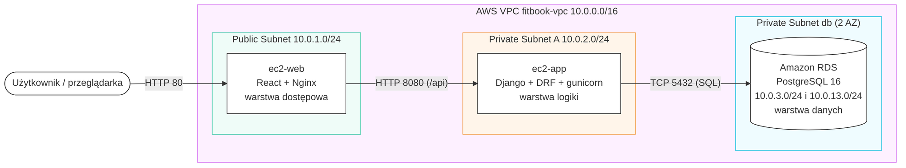

# FitBook

## O projekcie
FitBook to aplikacja webowa do rezerwacji zajęć fitness. Klienci przeglądają grafik zajęć, następnie się na nie zapisują, mogą również zarządzać swoimi rezerwacjami.  Instruktor lub recepcja tworzy zajęcia, ustala limity miejsc i widzi listę uczestników. Administrator może wszystko, w tym zarządzać rolami użytkowników. Aplikacja działa w architekturze 3-warstwowej w chmurze AWS.

Projekt realizowany jest w 4-osobowym zespole w ramach przedmiotu „Projekt zespołowy” na Uniwersytecie WSB Merito we Wrocławiu.

## Zespół

| Rola | Osoba | GitHub |
|---|---|---|
| PM / DevOps | Krzysztof Okołotowicz | @M1lachite |
| Frontend | Aneta Krzykwa | @Aneta2508 |
| Backend | Konrad Leśny | @Albako |
| DBA | Karolina Wasilewska | @KWas866 |

## Technologie

- Chmura: AWS
- Front-end: React + Vite, react-bootstrap, serwowany przez Nginx
- Back-end: Python, Django, Django REST Framework, JWT (simplejwt), gunicorn
- Baza danych: PostgreSQL 16 (Amazon RDS)
- Infrastruktura:  AWS (VPC, podsieci, Security Groups, EC2, CloudFront), Terraform
- Monitoring i koszty: Amazon CloudWatch (logi, metryki, dashboard), AWS Budgets
- Konteneryzacja: Docker, Docker Compose

## Architektura



Przepływ danych:

1. Przeglądarka pobiera statyczne pliki aplikacji React serwowane przez Nginx (Public Subnet).
2. React wysyła zapytania REST pod adres `/api/...`. Nginx przekazuje je do backendu (Private Subnet A, port 8080).
3. Django weryfikuje token JWT oraz uprawnienia roli użytkownika, waliduje dane i wykonuje zapytania SQL do bazy (port 5432).
4. Odpowiedź JSON wraca tą samą ścieżką do przeglądarki, a React aktualizuje widok interfejsu.

Reguły Security Groups: warstwa web przyjmuje ruch z internetu (80, 443), app przyjmuje ruch tylko od web (8080), a baza tylko od app (5432). Maszyny w podsieciach prywatnych nie mają adresów publicznych. Ruch użytkowników przechodzi przez CloudFront (HTTPS, przekierowanie HTTP → HTTPS), szczegóły w sekcji „Bezpieczeństwo sieciowe”.

## Struktura repozytorium

```
fitbook/
├── .env.example              # Szablon zmiennych środowiskowych (baza, Django); prawdziwy .env nie trafia do repo
├── .gitignore                # Wykluczenia z gita (.env, .venv, node_modules, dist, stan Terraforma)
├── docker-compose.yml        # Orkiestracja lokalna: baza PostgreSQL + backend + frontend
├── LICENSE                   # Licencja projektu
├── README.md                 # Główna dokumentacja projektu
├── docs/                     # Dokumentacja projektowa, diagramy i schematy
│   ├── architecture.png          #   wcześniejsza wersja schematu architektury
│   ├── architecture_update.png   #   aktualny schemat architektury (używany w README)
│   └── struktura.mmd             #   źródło aktualnego schematu (Mermaid)
│
├── backend/                  # Warstwa logiki (Django + Django REST Framework)
│   ├── config/               # Konfiguracja projektu (settings, główne adresy URL)
│   ├── accounts/             # Moduł użytkowników, ich rejestracja, logowanie JWT, role i uprawnienia
│   │   ├── models.py         #   model użytkownika z rolą (CLIENT, INSTRUCTOR, ADMIN)
│   │   ├── permissions.py    #   uprawnienia zależne od roli
│   │   ├── serializers.py    #   walidacja danych rejestracji i użytkowników
│   │   ├── views.py, urls.py #   endpointy /api/auth/ i /api/users/
│   │   └── migrations/       #   migracje bazy danych
│   ├── schedule/             # Moduł zarządzania grafikiem zajęć (FitnessClass) i rezerwacjami (Booking)
│   │   ├── models.py         #   modele i ograniczenia integralności
│   │   ├── serializers.py    #   walidacja danych zajęć i rezerwacji
│   │   ├── views.py, urls.py #   endpointy /api/classes/ i /api/bookings/
│   │   └── migrations/       #   migracje bazy danych
│   ├── Dockerfile            # Obraz backendu (Python 3.12, gunicorn na porcie 8080)
│   ├── .dockerignore         # Wykluczenia z kontekstu budowania (.venv, .env, cache)
│   ├── manage.py             # Narzędzie wiersza poleceń Django
│   └── requirements.txt      # Zależności Pythona (Django, DRF, simplejwt, psycopg, python-dotenv, gunicorn)
│
├── frontend/                 # Warstwa interfejsu (React + Vite + react-bootstrap)
│   ├── src/
│   │   ├── api/              # Klient HTTP (client.js: token JWT, błędy) i funkcje wywołań endpointów
│   │   ├── components/       # Komponenty wielokrotnego użytku (pasek dni, wiersz zajęć, okna, trasy chronione)
│   │   ├── context/          # Stan globalny: zalogowany użytkownik i komunikaty (toasty)
│   │   ├── pages/            # Widoki stron: grafik, rezerwacje, panel instruktora, użytkownicy, logowanie, rejestracja
│   │   ├── utils/            # Funkcje pomocnicze (obliczenia na datach)
│   │   ├── App.jsx           # Menu zależne od roli i tabela tras
│   │   ├── main.jsx          # Punkt startowy aplikacji
│   │   └── theme.css         # Motyw kolorystyczny i czcionka
│   ├── public/               # Pliki statyczne
│   ├── .env.example          # Szablon adresu API (VITE_API_URL)
│   ├── Dockerfile            # Budowanie dwuetapowe: build Reacta, potem serwowanie przez Nginx
│   ├── .dockerignore         # Wykluczenia z kontekstu budowania (node_modules, dist, .env)
│   ├── nginx.conf.template   # Konfiguracja Nginx: pliki statyczne i reverse proxy /api do backendu
│   ├── index.html            # Strona HTML, w której działa aplikacja React
│   ├── package.json          # Zależności Node.js i skrypty npm
│   ├── eslint.config.js      # Reguły lintera (npm run lint)
│   └── vite.config.js        # Konfiguracja Vite i proxy deweloperskie /api
│
└── infrastructure/           # Kod infrastruktury chmurowej (IaC, Terraform) – AWS
    ├── main.tf               # Wywołanie modułów
    ├── variables.tf          # Zmienne (nazwa projektu, region)
    ├── terraform.tfvars      # nazwa projektu i region
    ├── outputs.tf            # Wyjścia: identyfikatory zasobów i adresy IP
    ├── providers.tf          # Dostawca AWS
    ├── versions.tf           # Wymagane wersje Terraforma i dostawców
    ├── backend.tf            # Zdalny stan Terraforma w S3
    ├── README.md             # Instrukcja wdrożenia infrastruktury
    └── modules/
        ├── network/          # VPC, podsieci web/app/db, Internet Gateway, NAT Gateway
        ├── security/         # Security Groups izolujące warstwy (web → app → db)
        ├── compute/          # instancje EC2 (web, app), dystrybucja CloudFront (HTTPS), monitoring CloudWatch (monitoring.tf)
        └── rds/              # baza PostgreSQL (RDS)       
```

## Zmienne środowiskowe

Dane poufne są wyłącznie w zmiennych środowiskowych. Plik `.env` jest w `.gitignore`, a w repozytorium jest tylko szablon `.env.example`.

|Zmienna | Opis | Wartość lokalnie |
|---|---|---|
| `DJANGO_SECRET_KEY` | klucz kryptograficzny Django | własny, wygenerowany |
| `DJANGO_DEBUG` | tryb debugowania (w AWS: `False`) | `True` |
| `DJANGO_ALLOWED_HOSTS` | dozwolone nazwy hostów, rozdzielone przecinkami | `localhost,127.0.0.1` |
| `DB_NAME` | nazwa bazy | `fitbook` |
| `DB_USER` | użytkownik bazy | `fitbook` |
| `DB_PASSWORD` | hasło bazy | własne |
| `DB_HOST` | adres bazy (w Compose ustawiany automatycznie na `db`) | `localhost` |
| `DB_PORT` | port bazy (lokalnie 5433, w AWS 5432) | `5433` |
| `VITE_API_URL` (frontend) | adres API używany przez React | `/api` |
| `BACKEND_URL` (kontener Nginx) | adres backendu, do którego Nginx przekazuje `/api` | `http://backend:8080` |


## Instrukcja uruchomienia projektu:
## Uruchomienie lokalne (Docker Compose)

Wymagane oprogramownaie: Docker i Git.

```
git clone https://github.com/M1lachite/fitbook.git
cd fitbook
copy .env.example .env
```

Na Linuksie i macOS zamiast `copy` użyj `cp`. Uzupełnij plik `.env` (opis zmiennych poniżej). 
Klucz DJANGO_SECRET_KEY wygenerujesz poleceniem:

```
python -c "import secrets; print(secrets.token_urlsafe(50))"
```

Uruchomienie:

```
docker compose up --build -d
```
Komenda służąca do utworzenia konta administratora:
```
docker compose exec backend python manage.py createsuperuser
```
Aplikacja jest dostępna pod adresem:
Frontend: **http://localhost:8080**. Backend API: http://localhost:8001/api/. Zatrzymanie: `docker compose down` (dane bazy zostają w wolumenie, flaga `-v` je usuwa).

## Uruchomienie w trybie deweloperskim

Baza w kontenerze, backend i frontend bezpośrednio na komputerze.

**1. Baza danych** (z głównego folderu fitbook):

```
docker compose up -d db
```

**2. Backend** (wymagany Python 3.10 lub nowszy, w pliku `.env` ustaw `DB_HOST=localhost` i `DB_PORT=5433`):

```
cd backend
python -m venv .venv
.venv\Scripts\Activate.ps1
pip install -r requirements.txt
python manage.py migrate
python manage.py createsuperuser
python manage.py runserver 8001
```

**3. Frontend** (wymagany Node.js 20.19 lub nowszy):

```
cd frontend
copy .env.example .env.local
npm install
npm run dev
```

Aplikacja jest dostępna pod adresem http://localhost:5173. Serwer deweloperski przekazuje zapytania `/api` do backendu na porcie 8001.

## Role użytkowników

| Rola | Uprawnienia                                                                                         |
|---|-----------------------------------------------------------------------------------------------------|
| Klient (`CLIENT`) | przegląda grafik zajęć, zapisuje się na zajęcia, zarządza własnymi rezerwacjami                     |
| Instruktor / recepcja (`INSTRUCTOR`) | dodatkowo tworzy, edytuje i usuwa zajęcia, ustala limity miejsc, widzi listę zapisanych uczestników |
| Administrator (`ADMIN`) | wszystkie uprawnienia oraz zarządzanie użytkownikami i ich rolami                                   |

Rejestracja zawsze tworzy konto klienta. Zmiana roli na instruktora lub administratora wymaga interwencji konta z uprawnieniami administratora.

## Dokumentacja REST API

Wszystkie zasoby są dostępne pod prefiksem `/api`. Endpointy chronione wymagają nagłówka `Authorization: Bearer <token_access>`. Dostęp „Zalogowany" oznacza każde konto po zalogowaniu użytkownika, niezależnie od roli.

| Metoda | Endpoint | Dostęp | Opis                                                  | Kody statusu |
|---|---|---|-------------------------------------------------------|---|
| POST | `/api/auth/register/` | Publiczny | Rejestracja nowego konta klienta                      | 201, 400 |
| POST | `/api/auth/login/` | Publiczny | Logowanie i uwierzytelnienie, zwraca parę tokenów JWT | 200, 400, 401 |
| POST | `/api/auth/refresh/` | Publiczny | Odświeżenie tokenu access tokenem refresh             | 200, 401 |
| GET | `/api/auth/me/` | Zalogowany | Pobranie profilu i roli zalogowanego użytkownika      | 200, 401 |
| GET | `/api/classes/` | Publiczny | Lista zajęć (filtry: `from`, `to`, `instructor`)      | 200, 400 |
| GET | `/api/classes/{id}/` | Publiczny | Szczegółowe informacje o zajęciach                    | 200, 404 |
| POST | `/api/classes/` | Instruktor, Admin | Dodanie nowych zajęć                                  | 201, 400, 401, 403 |
| PUT | `/api/classes/{id}/` | Instruktor, Admin | Pełna edycja danych zajęć (komplet pól)               | 200, 400, 401, 403, 404 |
| PATCH | `/api/classes/{id}/` | Instruktor, Admin | Częściowa aktualizacja danych zajęć                   | 200, 400, 401, 403, 404 |
| DELETE | `/api/classes/{id}/` | Instruktor, Admin | Usunięcie zajęć i powiązanych rezerwacji              | 204, 401, 403, 404 |
| GET | `/api/classes/{id}/participants/` | Instruktor, Admin | Pobranie listy zapisanych uczestników                 | 200, 401, 403, 404 |
| GET | `/api/bookings/` | Zalogowany | Lista rezerwacji aktualnego użytkownika               | 200, 401 |
| POST | `/api/bookings/` | Zalogowany | Zapisanie się na wybrane zajęcia                      | 201, 400, 401 |
| DELETE | `/api/bookings/{id}/` | Zalogowany | Anulowanie własnej rezerwacji                         | 204, 401, 404 |
| GET | `/api/users/` | Admin | Lista wszystkich kont użytkowników                    | 200, 401, 403 |
| PATCH | `/api/users/{id}/` | Admin | Zmiana roli wybranego użytkownika                     | 200, 400, 401, 403, 404 |
| GET | `/api/health/` | Publiczny | Sprawdzenie, czy backend działa i ma połączenie z bazą (status UP / DOWN) | 200, 500 |

### Kody odpowiedzi

| Kod | Znaczenie |
|---|---|
| 200 | sukces |
| 201 | zasób utworzony |
| 204 | usunięto, brak treści |
| 400 | błędne dane (walidacja, brak wolnych miejsc, podwójna rezerwacja) |
| 401 | brak lub wygasły token |
| 403 | brak uprawnień dla roli |
| 404 | nie znaleziono zasobu |
| 500 | błąd serwera |

### Przykłady

**Rejestracja** (`POST /api/auth/register/`)

```json
{
  "username": "jan",
  "email": "jan@example.com",
  "first_name": "Jan",
  "last_name": "Kowalski",
  "password": "Haslo-Testowe-123"
}
```

Odpowiedź `201`:

```json
{
  "id": 5,
  "username": "jan",
  "email": "jan@example.com",
  "first_name": "Jan",
  "last_name": "Kowalski"
}
```

**Logowanie** (`POST /api/auth/login/`)

```json
{ "username": "jan", "password": "Haslo-Testowe-123" }
```

Odpowiedź `200`:

```json
{ "refresh": "<token refresh>", "access": "<token access>" }
```

**Utworzenie zajęć** (`POST /api/classes/`)

```json
{
  "title": "Joga poranna",
  "description": "Spokojne zajęcia rozciągające",
  "instructor": "Anna Kowalska",
  "start_time": "2026-10-26T08:00:00+01:00",
  "capacity": 15
}
```

Odpowiedź `201`:

```json
{
  "id": 1,
  "title": "Joga poranna",
  "description": "Spokojne zajęcia rozciągające",
  "instructor": "Anna Kowalska",
  "start_time": "2026-10-26T08:00:00+01:00",
  "capacity": 15,
  "booked": 0
}
```

**Zapis na zajęcia** (`POST /api/bookings/`)

```json
{ "fitness_class": 1 }
```

Odpowiedź `201`:

```json
{
  "id": 1,
  "fitness_class": 1,
  "class_title": "Joga poranna",
  "instructor": "Anna Kowalska",
  "start_time": "2026-10-26T08:00:00+01:00"
}
```

**Błąd walidacji** (`400`), gdy brak wolnych miejsc:

```json
{ "detail": "Brak wolnych miejsc na te zajęcia." }
```

**Błąd walidacji pola** (`400`), np. limit miejsc równy 0:

```json
{ "capacity": ["Upewnij się, że ta wartość jest większa lub równa 1."] }
```

**Zmiana roli** (`PATCH /api/users/5/`)

```json
{ "role": "INSTRUCTOR" }
```


## Wdrożenie

_Do uzupełnienia._

### Baza danych (Amazon RDS)

Baza działa w Amazon RDS i jest tworzona Terraformem (moduł `infrastructure/modules/rds`).

| Parametr | Wartość |
|---|---|
| Silnik | PostgreSQL 16 |
| Klasa instancji | `db.t4g.micro` |
| Nazwa bazy | `fitbook` |
| Użytkownik | `fitbook_admin` |
| Podsieci | dwie prywatne podsieci db (10.0.3.0/24 i 10.0.13.0/24) |
| Dostęp publiczny | brak |
| Multi-AZ | nie |

- **Hasło:** generuje AWS i przechowuje w Secrets Manager. Nie ma go w kodzie ani w stanie Terraforma.
- **Dostęp sieciowy:** baza przyjmuje ruch na porcie 5432 wyłącznie od warstwy app (Security Group `db` wpuszcza tylko Security Group `app`).
- **Migracje:** uruchamiają się automatycznie przy starcie kontenera backendu (`python manage.py migrate` w `backend/Dockerfile`).
- **Środowisko testowe:** brak kopii zapasowych i brak snapshotu przy usuwaniu bazy.

## Bezpieczeństwo sieciowe

Ruch między warstwami kontrolują trzy Security Groups (moduł `infrastructure/modules/security`). Stosujemy zasadę najmniejszych uprawnień: każda warstwa wpuszcza tylko ruch, którego potrzebuje do swojej roli, a warstwy app i db przyjmują ruch wyłącznie od Security Group warstwy wyżej, a nie z adresów IP.

### Reguły Security Groups

| Warstwa (Security Group) | Kierunek | Protokół / port | Źródło / cel | Uzasadnienie |
|---|---|---|---|---|
| Web (`fitbook-web-sg`) | Inbound | TCP 80 | 0.0.0.0/0 | HTTP z internetu (CloudFront przekierowuje użytkowników na HTTPS) |
| Web (`fitbook-web-sg`) | Inbound | TCP 443 | 0.0.0.0/0 | HTTPS z internetu |
| Web (`fitbook-web-sg`) | Inbound | TCP 22 | prefix list EC2 Instance Connect | Łączenie z konsoli AWS, port 22 nie jest otwarty dla internetu |
| Web (`fitbook-web-sg`) | Inbound | ICMP | 0.0.0.0/0 | Diagnostyka (ping) |
| Web (`fitbook-web-sg`) | Outbound | wszystkie | 0.0.0.0/0 | Odpowiedzi dla klientów, przekazywanie zapytań do warstwy app, pobieranie obrazów i pakietów |
| App (`fitbook-app-sg`) | Inbound | TCP 8080 | SG web | API backendu dostępne tylko z warstwy web |
| App (`fitbook-app-sg`) | Inbound | ICMP | SG web | Diagnostyka (ping) z warstwy web |
| App (`fitbook-app-sg`) | Outbound | wszystkie | 0.0.0.0/0 (przez NAT Gateway) | Połączenie z bazą, pobieranie obrazów i pakietów, agent SSM |
| DB (`fitbook-db-sg`) | Inbound | TCP 5432 | SG app | PostgreSQL dostępny tylko z warstwy app |
| DB (`fitbook-db-sg`) | Outbound | brak reguł | – | Baza sama nie nawiązuje połączeń |

Najważniejsze zasady:

- Żadna reguła nie wpuszcza ruchu z `0.0.0.0/0` na portach 22, 5432 ani 8080.
- Porty zarządcze: na warstwie web port 22 jest otwarty tylko dla usługi EC2 Instance Connect. Warstwy app i db nie mają reguł SSH, a na `ec2-app` wchodzimy przez Session Manager, który nie wymaga otwartego portu.
- Baza danych (RDS) nie ma adresu publicznego (`publicly_accessible = false`) i przyjmuje ruch wyłącznie od Security Group warstwy app.

### HTTPS i przekierowanie HTTP → HTTPS

Ruch użytkowników przechodzi przez Amazon CloudFront (moduł `infrastructure/modules/compute`, plik `cloudfront.tf`), który stoi przed serwerem Web (Nginx):

- **Certyfikat:** domyślny certyfikat CloudFront (`*.cloudfront.net`), bez własnej domeny.
- **Przekierowanie:** każde żądanie HTTP jest przekierowywane na HTTPS (odpowiedź `301` z nagłówkiem `Location: https://…`).
- **Połączenie CloudFront → serwer Web:** HTTP, port 80 (wewnątrz AWS).
- **Konfiguracja:** cache wyłączony (`Managed-CachingDisabled`), do serwera przekazywane są nagłówki od użytkownika (`Managed-AllViewer`), w tym `Host` i `Authorization` (token JWT), dozwolone są wszystkie metody HTTP.
- **Adres aplikacji:** domena dystrybucji z outputu `cloudfront_domain` (zmienia się po każdym `terraform destroy` i `terraform apply`). Pipeline CD odczytuje ją z AWS i dodaje do `DJANGO_ALLOWED_HOSTS`.

## Monitoring i FinOps

### Alert budżetowy (FinOps)

Koszty kontroluje budżet w AWS Budgets: `fitbook-budget` (typ Cost budget, okres miesięczny, kwota 10 USD, wszystkie usługi AWS). Skonfigurowano trzy progi ostrzegawcze oparte na kosztach rzeczywistych:

| Próg | Kwota |
|---|---|
| 50% | 5 USD |
| 80% | 8 USD |
| 100% | 10 USD |

Powiadomienia e-mail trafiają na adres administratora konta AWS. Budżet jest utworzony ręcznie w konsoli AWS (nie w Terraformie), więc nie znika po `terraform destroy`.

Pozostałe sposoby ograniczania kosztów:

- małe instancje: EC2 `t3.micro`, baza `db.t4g.micro`,
- retencja logów aplikacji ustawiona na 7 dni,
- środowisko jest stawiane na czas pracy i usuwane poleceniem `terraform destroy` (największy koszt generuje NAT Gateway).

### Health check

Endpoint `GET /api/health/` jest publiczny i sprawdza, czy backend działa oraz czy ma połączenie z bazą (zapytanie `SELECT 1`). Adres podajemy z ukośnikiem na końcu.

```
curl https://<domena-cloudfront>/api/health/
```

Odpowiedź `200`, gdy wszystko działa:

```json
{ "status": "UP", "database": "CONNECTED" }
```

Odpowiedź `500`, gdy baza jest niedostępna (treść błędu nie jest ujawniana, bo endpoint jest publiczny):

```json
{ "status": "DOWN", "database": "DISCONNECTED" }
```

Domena CloudFront znajduje się w outpucie Terraforma `cloudfront_domain`.

### Logi (CloudWatch Logs)

- **Backend:** logi kontenera (stdout/stderr) trafiają do Amazon CloudWatch Logs sterownikiem Dockera `awslogs`, do grupy `fitbook-backend` (strumień `backend`, retencja 7 dni). Grupę tworzy Terraform (`infrastructure/modules/compute/monitoring.tf`), a sterownik jest ustawiany w pipeline wdrożeniowym (`.github/workflows/deploy.yml`).
- **Dziennik żądań:** gunicorn zapisuje na stdout każde żądanie w formacie `adres "metoda ścieżka protokół" kod czas_w_ms`, np. `10.0.1.182 "GET /api/classes/ HTTP/1.1" 200 35`.
- **Baza danych:** logi PostgreSQL z RDS są eksportowane do grupy `/aws/rds/instance/fitbook-db/postgresql` (opcja `enabled_cloudwatch_logs_exports` w module `rds`). Tę grupę tworzy AWS automatycznie, więc nie jest zarządzana Terraformem i zostaje po `terraform destroy`.
- **Uprawnienia:** rola instancji `fitbook-ec2-ssm` ma politykę pozwalającą zapisywać logi i metryki w CloudWatch. Rola jest utworzona ręcznie poza Terraformem i nie znika po `terraform destroy`.

Logi przegląda się w konsoli AWS: CloudWatch, Log management, wybrana grupa logów.

### Dashboard (CloudWatch)

Dashboard `fitbook-monitoring` jest opisany w Terraformie (`infrastructure/modules/compute/monitoring.tf`) i zawiera cztery wykresy:

| Wykres | Źródło danych |
|---|---|
| Liczba żądań HTTP (2xx / 4xx / 5xx) | metryki `Requests2xx`, `Requests4xx`, `Requests5xx` (przestrzeń nazw `Fitbook`), liczone z dziennika żądań gunicorna przez filtry metryk |
| Czas odpowiedzi API (ms) | metryka `ResponseTimeMs` (przestrzeń nazw `Fitbook`), liczona z dziennika żądań |
| Zużycie procesora CPU (%) | standardowa metryka `CPUUtilization` (AWS/EC2) serwera aplikacji |
| Zużycie pamięci RAM (%) | metryka `MemoryUtilization` (przestrzeń nazw `Fitbook`), wysyłana przez skrypt |

Pamięć RAM jest zbierana prostym skryptem wysyłającym metrykę do CloudWatch co minutę, ponieważ instancja `t3.micro` ma ograniczone zasoby i zależało nam na jak najmniejszym narzucie. W środowisku produkcyjnym użylibyśmy oficjalnego CloudWatch Agenta. Skrypt jest instalowany na `ec2-app` w kroku pipeline wdrożeniowego jako timer systemd, więc po każdym ponownym postawieniu infrastruktury uruchamia się automatycznie.

Dashboard otwiera się w konsoli AWS: CloudWatch, Dashboards, `fitbook-monitoring`.

## Testy integracyjne i E2E

W katalogu `tests/` są automatyczne testy aplikacji napisane w Playwright:

| Plik | Rodzaj testu | Co sprawdza |
|---|---|---|
| `tests/api.spec.js` | integracyjne, REST API (13 testów) | statusy HTTP, nagłówek `Content-Type: application/json`, strukturę odpowiedzi: health check, lista zajęć, rejestracja, logowanie (tokeny JWT), dostęp do zasobów chronionych (401, 403) |
| `tests/e2e.spec.js` | E2E w przeglądarce (1 test) | scenariusz użytkownika: rejestracja, logowanie, widok konta i rezerwacji, wylogowanie |

Adres testowanej aplikacji podaje zmienna `LIVE_APP_URL`. Bez niej testy używają `http://localhost:8080` (aplikacja z Docker Compose).

### Uruchomienie lokalne

Wymagane: Node.js 20.19 lub nowszy oraz uruchomiona aplikacja.

```
docker compose up --build -d
cd tests
npm ci
npx playwright install chromium
npm test
```

Można też uruchomić tylko jedną grupę testów: `npm run test:api` albo `npm run test:e2e`.

Testy na wdrożonej aplikacji w chmurze (adres z outputu Terraforma `cloudfront_domain`):

```
$env:LIVE_APP_URL = "https://<domena-cloudfront>"
npm test
```

Na Linuksie i macOS: `LIVE_APP_URL=https://<domena-cloudfront> npm test`.

### Interpretacja wyników

- Każdy test jest wypisywany w konsoli ze znakiem ✓ (przeszedł) albo ✘ (nie przeszedł). Podsumowanie `14 passed` oznacza, że wszystkie testy zakończyły się sukcesem.
- Przy błędzie konsola pokazuje, która asercja zawiodła (wartość oczekiwana i otrzymana). Dla nieudanego testu Playwright zapisuje w `tests/test-results/` zrzut ekranu, nagranie wideo i ślad (trace).
- Raport HTML otwiera polecenie `npm run report`.
- Testy tworzą konta o nazwach zaczynających się od `qa_` i `e2e_`. Nie zmieniają ani nie usuwają istniejących danych.

### Testy w CI/CD

Zadanie `e2e-tests` w workflow `Deploy to AWS` uruchamia się po zakończeniu wdrożenia. Testy działają w trybie headless na publicznym adresie aplikacji (CloudFront).

- Zielone zadanie oznacza, że wdrożona aplikacja przeszła wszystkie testy. Czerwone oznacza, że któryś test się nie powiódł i trzeba sprawdzić log zadania.
- Artefakt `playwright-report` (raport HTML) jest zapisywany po każdym uruchomieniu. Artefakt `test-results-failure` (zrzuty ekranu, nagrania wideo, ślady) powstaje tylko wtedy, gdy testy się nie powiodły.
- Artefakty są na stronie podsumowania uruchomienia w zakładce Actions, w sekcji Artifacts. Raport po pobraniu i rozpakowaniu otwiera się poleceniem `npx playwright show-report <katalog>`.
